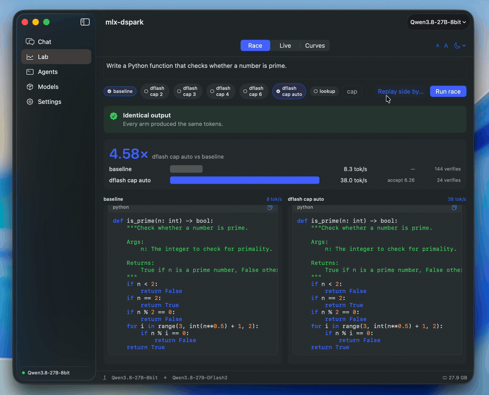

<p align="center">
  
</p>

<p align="center">
  <b>Lossless speculative decoding — DeepSeek's DSpark, z-lab's DFlash, DFlash 2 and DSpine — native on Apple Silicon via <a href="https://github.com/ml-explore/mlx">MLX</a>.</b>
  <br>Same output, just faster, for <b>Gemma-4, Qwen3 / 3.6 / 3.8, LFM2.5, MiniCPM5, Nanbeige, Muse-Glimmer, Ornith, Nemotron, Inkling-2-Mini and Bonsai</b> —
  <br>plus any matched drafter checkpoint. Run it at the CLI, from Python, or as an <b>OpenAI- and Anthropic-compatible server</b> for any local tool,
  <br>and drive <b>Claude Code</b> or <b>Codex</b> with a model on your own Mac.
</p>

<p align="center">
  <a href="https://arahim.dev/mlx-dspark/"></a>
  <a href="https://pypi.org/project/mlx-dspark/"></a>
  
  
  <a href="https://github.com/ARahim3/mlx-dspark/blob/main/LICENSE"></a>
</p>

<p align="center">
  
</p>

mlx-dspark runs EAGLE-family speculative-decoding drafters natively on Apple Silicon: DeepSeek's
**DSpark** (semi-autoregressive, from the [DeepSpec](https://github.com/deepseek-ai/DeepSpec) codebase,
used to accelerate DeepSeek-V4), z-lab's **DFlash** (block diffusion), and the two heads built on
DFlash since — Inco AI's **DFlash 2** and Tencent's **DSpine**. All of them are **lossless** — the
target verifies every token, so output is identical to normal decoding — and run under one verify loop,
so you can serve them, script them, or benchmark them head-to-head.

**Documentation:** [arahim.dev/mlx-dspark](https://arahim.dev/mlx-dspark/) — setup for every agent and
app, the HTTP API, a model picker, and how speculation behaves on a Mac.

> **What this is *not*:** DeepSeek-V4 inference. The targets are consumer-size models (Gemma-4, Qwen3,
> Meta's Muse-Glimmer, NVIDIA's Nemotron, PrismML's ternary Bonsai-27B, …) with published DSpark drafters —
> so this runs the real drafter method on a Mac, but the model producing tokens is one of those, not V4.
> V4 Flash/Pro (MoE, batched serving) is DSpark's own headline use case.

## Supported models

Every row auto-resolves its drafter from `--model` (any quant of the target matches). Measured warm on
an **M4 Pro**, medians of 3 — most rows with `mlx-dspark benchmark --trials 3` (three prompts:
chat/code/math), the Muse row per-content best (footnoted); full tables, baselines, and method in
[Results at a glance](#results-at-a-glance). Sorted by best measured speedup. These are
**short-context** numbers; at agent-sized prompts (16k–32k tokens) see
[Long context](#long-context-1632k-tokens):

<div align="center">

| target | best measured speedup | speed (chat → best) |
|---|---|---|
| **Nanbeige4.2-3B** (bf16, looped)[^nanbeige] | **4.31×** math · **2.50×** code · 1.98× chat | ~34–74 tok/s |
| **Gemma-4 12B** (8-bit) | **4.24×** math · **2.90×** code · **2.62×** chat | ~48–78 tok/s |
| **Qwen3.8-27B** (8-bit, DFlash 2)[^q38] | **4.22×** math · **3.80×** code · **2.99×** chat | ~25–35 tok/s |
| **MiniCPM5-2B** (bf16, dense)[^minicpm5] | **4.21×** math · **3.15×** code · **2.12×** chat | **~107–213 tok/s** |
| **LFM2.5-1.2B** (bf16, conv-hybrid)[^lfm2] | **3.83×** code · **3.82×** math · **2.40×** chat | **~240–385 tok/s** |
| **LFM2.5-2.6B** (bf16, conv-hybrid)[^lfm2] | **3.49×** math · **2.65×** code · **2.24×** chat | ~97–152 tok/s |
| **Muse-Glimmer-30B** (8-bit, dense)[^muse] | **3.27×** math · **2.50×** code · **2.22×** chat | ~18–26 tok/s |
| **Qwen3.8-27B** (4-bit, DFlash 2)[^q38] | **3.17×** code · **3.13×** math · **2.49×** chat | **~37–47 tok/s** |
| **Qwen3-8B** (8-bit) | **2.83×** math · **2.03×** code · 1.71× chat | ~50–83 tok/s |
| **Qwen3.6-27B** (8-bit) | **2.67×** math · **2.26×** chat · 1.96× code | ~16–22 tok/s |
| **Ornith-1.0-9B** (8-bit) | **2.53×** code · **2.48×** math · **2.21×** chat | ~59–68 tok/s |
| **Qwen3-4B** (8-bit) | **2.46×** math · 1.78× chat · 1.72× code | ~89–126 tok/s |
| **Qwen3-14B** (8-bit) | **2.36×** math · **2.11×** code · 1.62× chat | ~25–36 tok/s |
| **Inkling-2-Mini** (NVFP4, looped MoE)[^inkling] | **1.91× over stock mlx-vlm** (24.9 → 47.5 tok/s) · vs our own plain decode: **1.67×** math · **1.40×** code · 1.06× chat | ~37–57 tok/s |
| **Qwen3.6-35B-A3B** (4-bit, MoE)[^moe] | **1.67×** math · 1.24× code · 1.05× chat | **~91–145 tok/s** |
| **Nemotron-3.5-Lightning-30B-A3B** (4-bit, MoE+Mamba)[^nemotron] | **1.34×** math · **1.27×** code · 1.07× chat | **~87–112 tok/s** |
| **Ternary-Bonsai-27B** (2-bit) | **1.13×** code | ~26–29 tok/s |

</div>

<sub>The speed column is the measured range across the three benchmark contents at the row's
best configuration — chat at the low end, code/math at the high end (decoding speed depends on
what is being generated: copy- and structure-heavy content accepts longer drafts). Baselines and
per-content splits are in [Results at a glance](#results-at-a-glance).</sub>

<sub>This table is the set of pairs we have **measured and vouch for**, which is also exactly the
auto-resolve registry — that is the only thing the registry is for. It is *not* the set of models
that work: any DeepSpec-native drafter runs against any compatible target via `--drafter`, and any
target at all gets drafter-free speculation via `--mode auto`. See
[Bring your own drafter](#bring-your-own-drafter--what-runs-and-what-doesnt). Per-model caveats and
methodology live in the numbered footnotes at the end of this page — click a marker to jump.</sub>

<sub>Target precision: the quant shown is each model's measured best. Where a model ships
quants, **8-bit** gives the best ratio and 4-bit the highest absolute speed; the bf16 rows are
small models published in bf16. More under [Which target should I use?](#which-target-should-i-use).</sub>

<sub>Nothing in this table is hand-tuned per model or pinned to this M4 Pro: with no
`--max-draft`, mlx-dspark measures **your** machine's cost curves once (~5 s, cached) and derives
the draft cap from them, so an M1 or an M5 gets its own optimum
([how](https://arahim.dev/mlx-dspark/concepts/draft-caps/)).</sub>

**Copy-heavy code editing goes further:** when the model re-emits or refactors code already in its
context (the daily agent/assistant workload), match-scaled lookup drafts reach **4.5× on Gemma-12B**
(75 tok/s) and **3.6× on Ornith-9B** (93 tok/s). Any model *not* listed still gets drafter-free
lookup speculation via `--mode auto`.

## The Mac app

Everything below is also available as a **native Mac app** — chat with saved sessions, a model
manager that answers "will this fit my Mac?" before you download, live speculative-decoding
telemetry (per-round acceptance, this machine's measured cost curves), a **"This Mac"** roofline
view (your measured memory bandwidth, the plain-decode ceiling for the loaded model and how far
above it speculation runs, macOS memory pressure and swap), a decoder **Race** with a checked
lossless verdict, one-click coding-agent setup, and a menu-bar gauge with live tok/s and model
memory.

```bash
brew tap ARahim3/mlx-dspark https://github.com/ARahim3/mlx-dspark
brew trust arahim3/mlx-dspark          # Homebrew 6+: third-party taps need explicit trust
brew install --cask mlx-dspark
xattr -dr com.apple.quarantine /Applications/mlx-dspark.app   # not notarized yet: clear
                                       # quarantine once, or use System Settings › Privacy &
                                       # Security › "Open Anyway" after the first launch
```

(On Homebrew ≤ 5, `brew install --cask --no-quarantine mlx-dspark` still works and replaces
the `trust`/`xattr` steps — Homebrew 6 removed that flag.)

Or download the DMG from [Releases](https://github.com/ARahim3/mlx-dspark/releases) (`app-v*`
tags) and drag it to Applications. First launch sets up its own private engine runtime (no
Homebrew Python, no venv of yours touched, ~2–4 min once) and keeps the engine on the latest
release automatically; the app itself tells you when a newer app version exists
(`brew upgrade --cask mlx-dspark`). **`pip install mlx-dspark` stays engine-only** — the app is
not in the wheel, and the app never touches a pip-installed engine.

## Install

```bash
pip install mlx-dspark          # or:  uv pip install mlx-dspark
```

Apple Silicon + Python ≥ 3.10; installs mlx ≥ 0.32.0 automatically (0.32's quantized-matmul kernels are
what current speedup numbers are measured on). Model weights download from the Hugging Face cache on
first use (none bundled). No server framework is pulled in — the API server is built on the standard
library.

**Inkling-2-Mini needs one more command.** No mlx-vlm release has its looped model yet, so until
one does, install the mlx-vlm commit this pair was measured on (mlx-dspark tells you if it is
missing before it downloads anything):

```bash
uv pip install 'mlx-vlm @ git+https://github.com/Blaizzy/mlx-vlm@d998a6207b7dc613b52618646dbea13a4799f7ca'
```

Use that commit rather than the tip of mlx-vlm's `main`, which is still reworking this model.
Every other model here needs nothing beyond the `pip install` above.

## Quickstart

```bash
mlx-dspark generate --model mlx-community/Qwen3-8B-8bit --prompt "Explain rainbows."
mlx-dspark serve    --model mlx-community/Qwen3-8B-8bit   # OpenAI + Anthropic API on :8080
```

That's the whole setup — swap in any target from the [table above](#supported-models). Three
things worth knowing, then you can stop reading:

- **Pick a model, not a configuration.** `--model` takes any HF repo or local path (exactly like
  `mlx-lm`); the matching drafter *and* that pair's measured-best settings resolve automatically.
  A model that isn't in the table still gets drafter-free speculation via `--mode auto`, or pass
  `--drafter <repo>` yourself.
- **Don't set the draft cap.** The speedups above were measured on one M4 Pro — your machine's
  optimum is different, so mlx-dspark **measures your Mac** on a pair's first run (~5 s, cached)
  and derives its own cap from those curves. An M1 and an M5 each get their own answer.
  That default is the fastest setting on most pairs. `--max-draft auto` adapts the cap per round
  instead and can stop drafting where it would lose: worth it on a pair that hovers around
  break-even (the 2-bit Bonsai), at or a few percent under the default elsewhere.
  `--max-draft N` pins a value only if you've measured a better one.
- **It's lossless by construction.** The target verifies every drafted token, so the output is
  identical to running the target alone — every mode, every cap, only the speed changes. Want
  proof and your own numbers? `mlx-dspark benchmark --model <repo> --trials 3` is the same
  reproducible sweep this README's tables come from (the Mac app's **Race** shows it live, with
  a token-by-token identical-output verdict).

Prefer clicking to typing? [The Mac app](#the-mac-app) wraps all of this — including the
calibration and the model picker with "will it fit my Mac?" answered up front.

### Serve an API (OpenAI **and** Anthropic on one port)

```bash
mlx-dspark serve --model mlx-community/Qwen3-8B-8bit        # → http://127.0.0.1:8080/v1
#   --mode auto|dspark|dflash|lookup|baseline    which speculation to run (default: auto)
#   --max-batch 4         up to 4 concurrent requests share each forward (~2.5× aggregate)
#   --no-thinking         thinking off by default   ·   --reasoning-effort low|medium|xhigh
#   --context-window N    cap the context, to keep the KV cache inside your RAM
#   --kv-bits 8           quantized KV cache (a RAM saver at long context)
#   --api-key KEY         require a key on every route except /health
#   --no-model            start with nothing loaded; POST /admin/load loads (and swaps) later
```

Every flag is in `mlx-dspark serve --help` and the
[CLI reference](https://arahim.dev/mlx-dspark/reference/cli/); the endpoints, including
`/admin/load` and its per-swap overrides, are in the
[HTTP API reference](https://arahim.dev/mlx-dspark/reference/http-api/).

`--mode auto` picks the best available speculation for any target (a known DSpark drafter → else
DFlash → else drafter-free n-gram **lookup**), so *any* repo serves with some speedup and no extra flags.

Then point any OpenAI client at it — the speculative speedup is transparent:

```python
from openai import OpenAI
client = OpenAI(base_url="http://127.0.0.1:8080/v1", api_key="not-needed")
print(client.chat.completions.create(
    model="Qwen3-8B-8bit",
    messages=[{"role": "user", "content": "Explain rainbows briefly."}],
).choices[0].message.content)
```

**Works with any OpenAI-compatible client** — the same frontends people point at llama.cpp's
`llama-server` or Ollama work here by switching one setting: set the OpenAI base URL to
`http://127.0.0.1:8080/v1` (API key: anything). That covers Open WebUI, SillyTavern,
Continue/Cline, LibreChat, Raycast AI, and the rest of that ecosystem.

What the server gives you:

- **Three API dialects on one port:** OpenAI Chat Completions (`/v1/chat/completions`, streaming
  and not), Anthropic Messages (`/v1/messages`) and OpenAI Responses (`/v1/responses`).
- **The usual request controls:** `temperature`, `top_p`, `top_k`, `seed`, `stop`, penalties,
  `logprobs`, **tool calling**, a per-request thinking toggle and `reasoning_effort`.
- **The speedup on every response:** an `x_mlx_dspark` block with accept length, decode and
  end-to-end tok/s, time to first token and how much of the prompt the prefix cache served.
- **[Prefix caching](#prefix-caching)**, on by default: multi-turn chat and agents don't re-read
  the conversation each turn (first token in ~62 s cold vs 0.2–1 s on cached turns, ~8k-token
  context). **[Batching](#concurrent-throughput)** for concurrent requests with `--max-batch N`.
- **`GET /health`, `/metrics` and `/machine`** — the last one reports this Mac's measured memory
  bandwidth and the plain-decode ceiling for the loaded model.

More: the [server guide](https://arahim.dev/mlx-dspark/use/server/).

### Security

`mlx-dspark serve` is a local, single-user server. It binds `127.0.0.1` by default; if you expose
it further, use `--api-key` — then **every route except `GET /health` requires the key**
(`Authorization: Bearer …` or `x-api-key`). A checkpoint that ships its own Python
(`config.json: model_file`, `auto_map` custom classes) is **refused by default**, because
mlx-lm/transformers would otherwise import and run it; `--trust-remote-code` (or
`MLX_DSPARK_TRUST_REMOTE_CODE=1`) opts the whole process in, and there is no per-request
override on `/admin/load`. See [SECURITY.md](SECURITY.md) for the threat model and how to report.

### Use it from Claude Code

The same server also speaks Anthropic's **Messages API**, which is the dialect
[Claude Code](https://claude.com/claude-code) talks — so Claude Code can run entirely on a model
on your Mac. Start the server, then in another terminal:

```bash
mlx-dspark serve --model mlx-community/Qwen3-8B-8bit --no-thinking   # terminal 1
mlx-dspark claude                                                    # terminal 2
```

That's it — `mlx-dspark claude` finds the running server, points Claude Code at it, and hands over
the terminal. Anything after `--` goes to `claude` (`mlx-dspark claude -- --continue`).

**It changes nothing outside that one process.** The configuration is passed as the launched
process's environment and nowhere else: no shell profile edited, no `settings.json` written, no login
replaced. Your other Claude Code sessions keep their normal account, model and endpoint, and this
one reverts the moment it exits. Tool calls, multi-turn tool history and system prompts are
translated to the loaded model's own chat template, and a reasoning model's thinking comes back as
proper Anthropic `thinking` blocks. Wiring it up by hand, the environment variables and tips:
[Claude Code guide](https://arahim.dev/mlx-dspark/use/claude-code/).

**Measured** — each of these ran a real Claude Code session that read a buggy file and fixed it with
the `Edit` tool (M4 Pro, `--no-thinking`, identical task):

| target | accept length | prefix cache | wall clock |
|---|---|---|---|
| `mlx-community/Qwen3-8B-8bit` | 3.01 | on — 2 of 3 requests, ~26k tokens reused | **~2:20** |
| `mlx-community/Ornith-1.0-9B-8bit` | **5.07** | off — hybrid target, recurrent state can't be reused | ~4:10 |
| `mlx-community/gemma-4-12B-it-8bit` | 3.68 | on, but its sliding window wraps at this prompt size | ~4:10 |

The ranking is the point: **Claude Code sends ~18–26k tokens of system prompt and tool schemas on
every request**, so prefill dominates wall clock and the target that *reuses* it wins — Qwen3-8B is
nearly 2× faster here despite the lowest accept length of the three. Choose for prefix-cache
compatibility first, drafter quality second.

<sub>Measured on 0.6.0, when hybrid targets could not reuse a prefix. They can now
([Prefix caching](#prefix-caching), checkpoint mode), so Ornith's row should be faster today; it
has not been re-measured, and the numbers stand as recorded.</sub>

### Use it from Codex

The server also speaks OpenAI's **Responses API**, the dialect [Codex](https://github.com/openai/codex)
requires once its provider is configured with `wire_api = "responses"`. Point a `model_providers`
entry in `~/.codex/config.toml` at the running server's `/v1` base URL and Codex talks to whatever
is loaded. It is a **stateless** Responses implementation (`POST /v1/responses`, streaming and not;
no `previous_response_id`), which is all Codex needs: it resubmits its own history on each request.
The config block: [Codex guide](https://arahim.dev/mlx-dspark/use/codex/).

### Other agent clients

The Anthropic endpoint isn't Claude Code–specific. [**pi**](https://github.com/earendil-works/pi-mono)
works out of the box against either API — add a custom provider to `~/.pi/agent/models.json`:

```json
{ "providers": { "mlx-dspark": {
    "baseUrl": "http://127.0.0.1:8080", "api": "anthropic-messages", "apiKey": "mlx-dspark",
    "models": [{ "id": "Qwen3-8B-8bit", "contextWindow": 40960, "maxTokens": 8192 }] } } }
```

then `pi --provider mlx-dspark --model Qwen3-8B-8bit`. (Swap `"api"` for `"openai-completions"`
and `"baseUrl"` for `http://127.0.0.1:8080/v1` to use the OpenAI endpoint instead — both work.)

**pi is markedly better suited to a local model than Claude Code**, for one reason: its system
prompt is **~1.5k tokens against Claude Code's ~18–26k**. Since prefill dominates, that lands
directly on the clock — the same one-bug fix takes **~6 s** instead of ~2:20, and a four-tool
task (read, two edits, read, write) finishes in **8.5 s at 24 tok/s** on Qwen3-8B.

Three rules for any agent on a local model:

- **Use a tool-calling model.** Qwen3-8B and up handle it; smaller models flail.
- **The agent moves the clock more than the model does.** Its prompt size is the dominant cost.
- **`--no-thinking` is a speed knob, and prefix caching does most of the work** — leave the
  cache on. An over-long request is refused with the wording agents recognise as a context limit,
  so they compact and retry.

More clients and notes: [Agents and apps](https://arahim.dev/mlx-dspark/use/agents-and-apps/).

### One-shot generation (CLI)

```bash
# downloads the drafter + instruct target on first run
mlx-dspark generate --model mlx-community/Qwen3-4B-8bit --prompt "Explain how rainbows form."

# baseline (plain target) vs dspark — same output, faster (record each, stack for a demo)
mlx-dspark generate --model mlx-community/Qwen3-4B-8bit --mode baseline --prompt "..." --max-new-tokens 400
mlx-dspark generate --model mlx-community/Qwen3-4B-8bit --mode dspark   --prompt "..." --max-new-tokens 400

# z-lab DFlash drafter (--max-draft 0 = full 16-block, its native operating point)
mlx-dspark generate --model mlx-community/gemma-4-12B-it-8bit --mode dflash --max-draft 0 --prompt "Write a binary search."

# sampled (not greedy) — lossless w.r.t. the target at temperature T (dspark and dflash)
mlx-dspark generate --model mlx-community/Qwen3-4B-8bit --prompt "Write a short poem." --temperature 1.0 --top-p 0.95 --seed 0
```

`python -m mlx_dspark …` works too, and the old flat `--prompt …` form still maps to `generate`.

### Python

```python
from mlx_dspark import load_pair, speculative_generate

target, tok, drafter, cfg = load_pair("mlx-community/Qwen3-8B-8bit")   # drafter auto-resolved
res = speculative_generate(target, tok, drafter, "Explain how rainbows form.")
print(res.text, res.mean_accept_len, res.tokens_per_sec)
```

```python
from mlx_dspark import load_dflash_pair, dflash_generate   # z-lab DFlash instead

target, tok, drafter, cfg = load_dflash_pair("mlx-community/gemma-4-12B-it-8bit")
res = dflash_generate(target, tok, drafter, "Write a binary search in Python.")  # max_draft_tokens=None = full block
print(res.text, res.mean_accept_len, res.tokens_per_sec)
```

## Models

Pass **any** target repo/path to `--model`; the matched drafter auto-resolves for the targets below
(quantization-agnostic — a `-4bit` / `-8bit` / `-bf16` of the same model resolves the same drafter). For
anything else, add `--drafter <repo>`. `mlx-dspark models` prints this table, with what is already
on your Mac.

| target (`--model`) | DSpark drafter (`--mode dspark`) | DFlash drafter (`--mode dflash`) | peak RAM |
|---|---|---|---|
| `mlx-community/Qwen3-4B-8bit`        | `deepseek-ai/dspark_qwen3_4b_block7`   | `z-lab/Qwen3-4B-DFlash-b16`  | ~8 GB  |
| `mlx-community/Qwen3-8B-8bit`        | `deepseek-ai/dspark_qwen3_8b_block7`   | `z-lab/Qwen3-8B-DFlash-b16`  | ~11 GB |
| `mlx-community/Qwen3-14B-8bit`[^qwen14b] | `deepseek-ai/dspark_qwen3_14b_block7` | — | ~19 GB |
| `mlx-community/gemma-4-12B-it-8bit`  | `deepseek-ai/dspark_gemma4_12b_block7` | `z-lab/gemma4-12B-it-DFlash` | ~15 GB |
| `mlx-community/Qwen3.8-27B-4bit`[^q38] | `RedHatAI/Qwen3.8-27B-speculator.dspark` (Red Hat, speculators) | `incoai/Qwen3.8-27B-DFlash2` (**default**) | ~18 GB |
| `mlx-community/Qwen3.8-27B-8bit`[^q38] | `RedHatAI/Qwen3.8-27B-speculator.dspark` (Red Hat, speculators) | `incoai/Qwen3.8-27B-DFlash2` (**default**) | ~29 GB |
| `mlx-community/Qwen3.6-27B-8bit`     | `satgeze/Qwen3.6-27B-DSpark` (community) | — | ~32 GB |
| `mlx-community/Ornith-1.0-9B-8bit`   | `stanleyphoong/Ornith-1.0-9B-DSpark` (community) | — | ~13 GB |
| `mlx-community/Muse-Glimmer-30B-4bit`[^muse] | `DaoCloud/Muse-Glimmer-30B-DSpark` (community, DFlash-lineage) | — | ~26 GB (4-bit) / ~40 GB (8-bit) |
| `LiquidAI/LFM2.5-2.6B-MLX-bf16`[^lfm2] | `LiquidAI/LFM2.5-2.6B-DSpark` (official) | — | ~7 GB |
| `LiquidAI/LFM2.5-1.2B-Instruct-MLX-bf16`[^lfm2] | `LiquidAI/LFM2.5-1.2B-Instruct-DSpark` (official) | — | ~4 GB |
| `LiquidAI/LFM2.5-8B-A1B-MLX-bf16`[^lfm2] | `LiquidAI/LFM2.5-8B-A1B-DSpark` (official) | — | ~19 GB |
| `MercuriusDream/Nanbeige4.2-3B-mlx-bf16`[^nanbeige] | `Nanbeige/Nanbeige4.2-3B-DSpark` (official, SpecForge) | — | ~10 GB |
| `mlx-community/MiniCPM5-2B-bf16`[^minicpm5] | `openbmb/MiniCPM5-2B-DSpark` (official, DeepSpec) | — | ~6 GB |
| `thinkingmachines/Inkling-2-Mini`[^inkling] | ships inside the model repo (`mtp.safetensors`) | — | ~22 GB |
| `mlx-community/Qwen3.6-35B-A3B-4bit`[^moe] | `Koopah/Qwen3.6-35B-A3B-NVFP4-DSPARK` (community) | — | ~23 GB |
| `mlx-community/NVIDIA-Nemotron-3.5-Lightning-30B-A3B-4bit`[^nemotron] | `mlx-community/NVIDIA-Nemotron-3.5-Lightning-30B-A3B-DSpark-bf16` (NVIDIA head, MLX) | — | ~20 GB |
| `prism-ml/Ternary-Bonsai-27B-mlx-2bit` | `Rahim/Ternary-Bonsai-27B-dspark` | — | ~12 GB |

- **Peak RAM** is measured on an M4 Pro (the target at the quant shown + a 4-bit drafter + KV
  cache) at chat-length context; add headroom for macOS. A 4-bit quant of an 8-bit row roughly
  halves the target's share.
- **Long context adds cache on top**, linearly: the target's attention KV plus the drafter's
  context. Measured on Qwen3.8-27B: **0.086 GB per 1k tokens**, the same for both quants (the
  cache is bf16 whatever the weight bits) — ~11 GB at 128k, ~23 GB at its full 256k, so the 4-bit
  needs ~26 GB in total at 128k and the 8-bit ~40 GB. `--kv-bits 8` roughly halves the
  attention-KV share; `--context-window` caps it, and requests past the cap get the "prompt is
  too long" error agent clients auto-compact on. Not measured for the other rows.
- **Use the matched *instruct* target** the drafter was trained against — a base model drops
  acceptance sharply.
- **Rows marked *(community)*** use drafters published by the community rather than the model's
  authors; quality varies more, and it shows up directly as acceptance length (= your speedup).
  Ornith's is the strong case (qualified by its author: 17/17 gates, 95% of the DSpark paper's
  reference acceptance); Qwen3.6-27B's is block-15, trained against the bf16 target, and measured
  here on the 8-bit quant only.

**Already use LM Studio?** Its MLX downloads are reused: pass the same `publisher/model` id LM
Studio shows (e.g. `--model lmstudio-community/Qwen3-8B-MLX-8bit`) and the engine loads it from
`~/.lmstudio/models` instead of downloading again. MLX downloads only — GGUF files are a
different format.

**Keep models somewhere else?** Point `MLX_DSPARK_MODEL_DIRS` at those folders (`:`-separated)
and they are searched before anything is downloaded. A plain path
(`--model ~/models/Qwen3.8-27B-4bit`) always works, your Hugging Face cache is honoured wherever
`HF_HOME` puts it, and `mlx-dspark doctor --json` lists every folder the engine looks in.

**Serving other devices?** `mlx-dspark serve --host 0.0.0.0 --api-key <key>` listens on every
interface; with a key set, every route but `/health` needs it.

`--drafter` lets you run **any** other matched z-lab / DeepSpec checkpoint with no code change and no
registry entry — the registry only saves you from having to name the drafter:

```bash
# a pair we have measured -> the drafter auto-resolves
mlx-dspark generate --model mlx-community/Qwen3-14B-8bit --prompt "Explain how rainbows form."

# anything else -> name the drafter yourself; identical machinery from here on
mlx-dspark generate --model mlx-community/Qwen3-32B-8bit \
  --drafter deepseek-ai/dspark_qwen3_32b_block7 --prompt "Explain how rainbows form."
```

### Bring your own drafter — what runs and what doesn't

New DSpark/DFlash drafters keep landing on HF in **several different packagings**; here is the honest
compatibility contract (loaders refuse incompatible checkpoints with an error naming the reason, never
a silent mis-load):

| checkpoint style | example | status |
|---|---|---|
| **DeepSpec-native standalone drafter** (qwen3/gemma4 backbone, any size/quant) | `deepseek-ai/dspark_qwen3_32b_block7` | ✅ runs via `--drafter` — no registry entry needed (4B/8B/14B/gemma-12B are measured *and* registered, so they need no flag; larger sizes should run — reports welcome) |
| **z-lab DFlash adapter** for a qwen3/gemma4-family target | `z-lab/Qwen3-8B-DFlash-b16` | ✅ runs via `--drafter` (the loop is read from the checkpoint; `--mode dflash` also works) |
| **DFlash 2** (Inco AI: candidate selector + dynamic convs) | `incoai/Qwen3.8-27B-DFlash2` | ✅ runs via `--drafter`; the Qwen3.8-27B heads are measured *and* registered (auto-resolve, and `--mode auto` picks them as that target's best) |
| **DSpine** (Tencent: a block-causal DFlash backbone with predecessor-conditioned decoding, [paper](https://arxiv.org/abs/2609.36173), Apache-2.0) | `tencent/Qwen3.8-27B-DSpine-b16` | ✅ runs via `--drafter` on `generate` and `serve`, trees and `--max-draft auto` included. **2.70×** on Qwen3.8-27B-4bit at the measured cap 7 (accept 5.08, 38.4 tok/s); DFlash 2 (2.93×) stays the registered default |
| **PrismML dspark GGUF** (Bonsai-27B) | `prism-ml/Ternary-Bonsai-27B-gguf` → `*-dspark-bf16.gguf` | ✅ pre-converted repacks auto-resolve (`Rahim/*-dspark`); any future GGUF-only drop runs via `--drafter gguf:<repo>/<file>.gguf` (converted locally, once) |
| **vLLM "speculators" format** (`dspark` algorithm) | `makora-ai/gemma4-26b-a4b-dspark`, `mgoin/Qwen3-8B-speculator.dspark` | ✅ runs via `--drafter` — the config schema is translated on load, reduced draft vocabularies included. Other speculators algorithms (eagle/eagle3) are refused by name. `makora-ai/gemma4-26b-a4b-dspark` measures **1.27×** on `mlx-community/gemma-4-26b-a4b-it-8bit` (`--max-draft 2 --no-lookup-drafts`); not registered yet |
| **LiquidAI LFM2.5-DSpark** (for the lfm2 / lfm2_moe conv+attention hybrid targets) | `LiquidAI/LFM2.5-2.6B-DSpark` | ✅ measured *and* registered (auto-resolves, any quant). The 2.6B/1.2B are strong wins; the 8B-A1B MoE is a modest win at bf16 (~1.3×) and a net loss at 8-bit[^lfm2] |
| **Full model with embedded drafter** | `deepseek-ai/DeepSeek-V4-Pro-DSpark` (893 GB, MLA+MoE) | ❌ different architecture & packaging — out of scope for consumer Macs |
| **DFlash+Markov community hybrids** | `Hikari07jp/DSpark-Gemma-4-31B-draft` | ❌ hybrid head — not yet |

Targets: any dense mlx-lm text model routes automatically; a one-time load probe verifies the
hidden-state tap reproduces the model's own forward and fails loudly if the family needs bespoke
support (drafter-free `--mode lookup` / `--mode auto` still work with **any** target). If you run a
pair we haven't measured, `mlx-dspark benchmark --json` produces a device-stamped result we can fold
into the table — please share it. Getting a good pairing: [Bring your own drafter](https://arahim.dev/mlx-dspark/models/bring-your-own/).

**Very small targets are not worth a drafter.** Speculation buys time in proportion to what one
target step costs, so below ~4B there is little to win. Measured, so you don't spend the download:
[`satgeze/Qwen3.5-0.8B-DSpark`](https://huggingface.co/satgeze/Qwen3.5-0.8B-DSpark) on
Qwen3.5-0.8B-8bit runs correctly and losslessly but comes out at **0.96×** — the target is already
215 tok/s, and a draft round costs nearly as much as the step it skips. Run these models plain.

### PrismML Bonsai 27B (ternary / 1-bit Qwen3.6-27B)

[Bonsai 27B](https://huggingface.co/prism-ml/Ternary-Bonsai-27B-mlx-2bit) is PrismML's 1.7-bit
ternary rebuild of Qwen3.6-27B — a 27B-class reasoning model in ~8 GB. Its DSpark drafter is
published **GGUF-only** and, per PrismML's own docs, does not accelerate on Macs yet; mlx-dspark
runs it from a 1:1 repack:

```bash
mlx-dspark generate --model prism-ml/Ternary-Bonsai-27B-mlx-2bit \
  --max-draft auto --prompt "Implement binary search in Python."
```

Measured on an M4 Pro (greedy, warm): baseline ~25.5 tok/s, **~1.15× on code and structured
content**, about break-even on open chat, output byte-identical to plain greedy decoding. The
ceiling is the 2-bit quantization itself — extra verify rows on a 2-bit model are compute-bound
while its plain step is very fast — so **`--max-draft auto`** is the setting to use here: it can
park speculation on content where it would lose. The **1-bit** pack is refused with a pointer to
plain generation (speculation measures a net loss on it, 0.71–0.77×). More on the
[Bonsai model page](https://arahim.dev/mlx-dspark/models/ternary-bonsai-27b/).

## How it works

- **DSpark** — a parallel backbone (5 layers) consumes the target's hidden states (EAGLE3-style) and
  proposes a 7-token block at once; a rank-256 **Markov head** adds a cheap previous-token correction that
  kills "suffix decay"; a confidence head scores each position (optional adaptive block length).
- **DFlash** (`--mode dflash`) — a *block-diffusion* drafter that denoises a whole 16-token block in one
  parallel pass and reuses the target's own embed/lm-head.
- **DFlash 2** and **DSpine** (also `--mode dflash`) — the DFlash backbone with a fix for its
  incoherent later positions: DFlash 2 keeps the target head's top candidates per position and
  walks one coherent chain through them; DSpine conditions each position on its predecessor.
- **Lookup** (`--mode lookup`, and inside `dspark` on most pairs) — no drafter at all: when the
  current suffix already occurred in the context, the continuation that followed it is the draft.
- The target **verifies** every token, so output is **greedy-correct by construction** (identical to plain
  decoding up to floating-point tie-breaking). `--temperature > 0` switches to lossless speculative
  *sampling* — an exact sample from the target at temperature T (with `--top-p` / `--top-k`).

The drafter loads 1:1 from the HF checkpoint and is **4-bit quantized** by default (cheap to run each round;
quantization doesn't change acceptance — that's set by the drafter↔target match). The longer
version, with what "lossless" means exactly: [Speculative decoding](https://arahim.dev/mlx-dspark/concepts/speculative-decoding/).

## Which target should I use?

**Mode first, because it's the short one: `--mode auto` picks each pair's measured best.**
That is DSpark everywhere except **Qwen3.8-27B, where the DFlash 2 drafter is the default on both
quants**. Which drafter wins depends on the model and has moved with MLX versions
([DSpark or DFlash?](https://arahim.dev/mlx-dspark/concepts/speculative-decoding/#dspark-or-dflash)); `mlx-dspark benchmark`
settles it on your own machine.

**Target, by the Mac you have** (all numbers from [the table above](#supported-models); speedups
and caps are this M4 Pro's — yours are derived fresh on first run):

- **~48 GB** — `Qwen3.8-27B-8bit` (best ratio in the project: **3.66× with its DFlash 2
  drafter**, 4.22× on math — `--mode auto` picks it; Red Hat's DSpark head ties it, 3.79× paired,
  with ~3× on chat) or `Muse-Glimmer-30B-8bit` (a dense 30B, 2.5× at 8-bit). Both ~29–40 GB
  resident.
- **~24–36 GB** — `Qwen3.8-27B-4bit` (27B quality in ~18 GB at **~31–45 tok/s, the fastest
  decode among the 27B-class targets** — DFlash 2 via `--mode auto`, no cap flag needed), `gemma-4-12B-it-8bit`
  (big ratio *and* real speed: 3.25×, ~48–78 tok/s), or `Qwen3.6-27B-8bit`.
- **~16 GB** — `Ornith-1.0-9B-8bit` (2.4× at ~59–68 tok/s, the mid-size sweet spot),
  `Qwen3-8B-8bit`, or `Qwen3-4B-8bit` (~89–126 tok/s, fits ~8 GB).
- **~8 GB** — `MiniCPM5-2B-bf16` (**3.16×** mean, 4.21× on math, ~107–213 tok/s in ~6 GB
  resident — the best small-Mac pick, and a tool-calling model).
- **Raw tokens per second above all** — the MoEs: `Qwen3.6-35B-A3B-4bit` (~91–145 tok/s).
  Their *speedup ratio* is modest for a structural reason (sparse targets are already fast —
  see the MoE note under [Results](#results-at-a-glance)), but nothing here decodes faster.
- **Agents (Claude Code, pi, …)** — prefill dominates agent turns, so **prefix-cache reuse
  matters more than acceptance**: `Qwen3-8B-8bit` wins wall-clock in the
  [Claude Code comparison](#use-it-from-claude-code), and since v0.10.1 the hybrid targets
  (Qwen3.8/Qwen3.6/Ornith) cache too. Use `--no-thinking` and an 8B+ tool-calling model.

For target *precision*, where a model ships quants: **8-bit** is the sweet spot (best ratio + quality);
**4-bit** gives the highest absolute throughput and fits smaller Macs, at a smaller speedup ratio. Models
published in bf16 (LFM2.5, MiniCPM5, Nanbeige) run well as they are. The drafter stays 4-bit either way.
A picker by Mac size, with the reasoning: [Choose a model](https://arahim.dev/mlx-dspark/start/choose-a-model/).

**On copying caps and flags from these tables.** Every cap and flag shown is *this M4 Pro's*
derived optimum for that exact quant — a starting point, not a setting to paste in. Two things
that trip people up:

- **Don't copy the cap.** With no `--max-draft`, mlx-dspark derives it from your machine's own
  curves (per model + quant + mlx version). A faster, higher-bandwidth machine can land *lower*,
  not higher — an M5 Max may pick cap 2 for the 8-bit 27B where this M4 Pro picks 7, because
  cheaper verify shifts the optimum down, and forcing 7 there is a small net loss. Prefer no
  flag.
- **`--confidence-threshold` is drafter-specific, not just quant-specific.** It pays only where
  the verify curve still rises inside the cap's window *and* the drafter leaves acceptance
  headroom for early truncation to recover — among the rows here, the Qwen3.6-35B-A3B one (see
  the MoE note under [Results](#results-at-a-glance)). Don't paste the flag across quants or drafters.

## Results at a glance

**DSpark** vs plain greedy decoding of the same model, each at **its own derived cap** (M4 Pro 48 GB,
warm, 4-bit drafter, 200 tokens, end-to-end tok/s). **Re-measured 2026-09-27** on mlx 0.32.2 with
the current kernels (`mlx-dspark benchmark --trials 3`, zero-flag derived caps) for every row whose
models were on this machine: Gemma-4 12B, Qwen3-4B/8B, Qwen3.8-27B (both quants), LFM2.5, MiniCPM5
and Nanbeige. The other rows keep their earlier stamps (mlx 0.32.0–0.32.1, 2026-07-22 to
2026-08-12) and predate the 2026-09 verify kernel — the 8-bit ones among them would likely move
the way Qwen3-4B/8B and Gemma-4 did. The Qwen3.8-27B rows are its DSpark head since 2026-09-28,
Red Hat's (from the paired head-to-head in the next section — same prompts and semantics, High
Power mode); that target's *default* is DFlash 2. Every number is a median of 3 runs over the
harness's three prompts, and the tok/s columns are the mean across them. Reproduce any row with
that command.

The cap column is never hard-coded: it is derived from each machine + model + quant's measured
cost curves, which is why Bonsai sits at 2, the older 8-bit stamps at 4, and every re-measured
row at 7 — same code, different measured curves
([Draft caps and calibration](https://arahim.dev/mlx-dspark/concepts/draft-caps/)).

| target | cap | accept len | baseline | mlx-dspark | speedup | chat / code / math |
|---|---|---|---|---|---|---|
| **Qwen3.8-27B** (8-bit, hybrid)[^q38] | 7 | 5.55 | 8.2 tok/s | 31.1 tok/s | **3.79×** | 3.03× / 4.01× / 4.32× |
| **LFM2.5-1.2B** (bf16, conv-hybrid)[^lfm2] | 7 | 5.28 | 99.6 tok/s | 333.5 tok/s | **3.35×** | 2.40× / 3.83× / 3.82× |
| **Gemma-4 12B** | 7 | 4.98 | 18.4 tok/s | 59.8 tok/s | **3.25×** | 2.62× / 2.90× / 4.24× |
| **MiniCPM5-2B** (bf16, dense)[^minicpm5] | 7 | 4.87 | 50.6 tok/s | 159.7 tok/s | **3.16×** | 2.12× / 3.15× / 4.21× |
| **Nanbeige4.2-3B** (bf16, looped)[^nanbeige] | 7 | 3.95 | 17.3 tok/s | 50.6 tok/s | **2.92×** | 1.98× / 2.50× / 4.31× |
| **LFM2.5-2.6B** (bf16, conv-hybrid)[^lfm2] | 7 | 4.00 | 43.6 tok/s | 121.7 tok/s | **2.79×** | 2.24× / 2.65× / 3.49× |
| **Qwen3.8-27B** (4-bit, hybrid)[^q38] | 7 | 4.83 | 14.7 tok/s | 38.6 tok/s | **2.63×** | 2.25× / 2.81× / 2.83× |
| **Muse-Glimmer-30B** (8-bit, dense)[^muse] | 4 | 3.31 | 8.2 tok/s | 20.2 tok/s | **2.47×** | 1.97× / 2.45× / 2.99× |
| **Ornith-1.0-9B** (hybrid)[^community] | 4 | 3.64 | 26.7 tok/s | 64.2 tok/s | **2.40×** | 2.21× / 2.53× / 2.48× |
| **Qwen3.6-27B** (8-bit, hybrid)[^community][^q27] | 4 | 3.15 | 8.4 tok/s | 19.2 tok/s | **2.29×** | 2.26× / 1.96× / 2.67× |
| **Qwen3-8B** | 7 | 3.37 | 29.5 tok/s | 64.5 tok/s | **2.19×** | 1.71× / 2.03× / 2.83× |
| **Qwen3-14B**[^qwen14b] | 4 | 2.87 | 15.3 tok/s | 31.0 tok/s | **2.03×** | 1.62× / 2.11× / 2.36× |
| **Qwen3-4B** | 7 | 3.23 | 51.7 tok/s | 102.5 tok/s | **1.98×** | 1.78× / 1.72× / 2.46× |
| **Inkling-2-Mini** (NVFP4, looped MoE)[^inkling] | 3 | 2.41 | 34.6 tok/s (stock mlx-vlm: 24.9) | 47.5 tok/s | **1.37×** (1.91× over stock) | 1.06× / 1.40× / 1.67× |
| **Qwen3.6-35B-A3B** (4-bit, MoE, hybrid)[^community][^moe] | conf | 4.72 | 86.9 tok/s | 114.5 tok/s | **1.32×** | 1.05× / 1.24× / 1.67× |
| **Nemotron-3.5-Lightning-30B-A3B** (4-bit, MoE+Mamba, hybrid)[^nemotron] | 3 | 3.28 | 91.4 tok/s | 100.9 tok/s | **1.10×** | 0.95× / 1.23× / 1.13× |
| **Ternary-Bonsai-27B** (2-bit, hybrid) | 2 | 2.60 | 25.4 tok/s | 27.2 tok/s | **1.07×** | 1.01× / 1.13× / 1.07× |

### Qwen3.8-27B: DFlash 2 and the DSpark head, paired

The table above is DSpark-mode; on Qwen3.8-27B the **DFlash 2** drafter
([`incoai/Qwen3.8-27B-DFlash2`](https://huggingface.co/incoai/Qwen3.8-27B-DFlash2)) is the
default — `--mode auto`, and the Mac app, resolve it for both quants. Both drafters run at the
**identical verify width** (cap 7); since 2026-09-28 the DSpark head is Red Hat's
([`RedHatAI/Qwen3.8-27B-speculator.dspark`](https://huggingface.co/RedHatAI/Qwen3.8-27B-speculator.dspark)),
and it closes the gap the earlier DSpark heads left: DFlash 2 still leads at 4-bit, the two tie
at 8-bit. Paired in one process (arms interleaved per prompt, the benchmark's prompts and
semantics: 200 tok, end-to-end tok/s, 3-trial medians), High Power mode, current kernels:

**8-bit** (baseline 8.2 tok/s):

| method (cap 7) | mean | chat | code | math | accept | tok/s |
|---|---|---|---|---|---|---|
| DSpark (`RedHatAI`) | **3.79×** | 3.03× | **4.01×** | **4.32×** | **5.55** | **31.1** |
| **DFlash 2** | 3.74× | **3.07×** | 3.93× | 4.23× | 5.42 | 30.8 |

**4-bit** (baseline 14.7 tok/s, ~18 GB):

| method (cap 7) | mean | chat | code | math | accept | tok/s |
|---|---|---|---|---|---|---|
| DSpark (`RedHatAI`, tree verify) | 2.80× | 2.48× | 2.97× | 2.94× | 5.08 | 41.1 |
| **DFlash 2** (tree verify) | **2.93×** | **2.49×** | **3.17×** | **3.13×** | **5.37** | **43.1** |

Both 4-bit rows were re-measured on 2026-11-08 with v0.20.4's tree verify, drafter overlap and
deferred commit (same harness, High Power mode): DFlash 2 up from 2.72× / 40.0 tok/s, the Red Hat
DSpark head up from 2.63× / 38.6 tok/s on 2026-09-28. The 8-bit table is still the 2026-09-28
measurement and predates those gains.

DFlash 2 adds a **candidate path selector** and **dynamic convolutions** to the DFlash backbone:
acceptance rises ~+1.1–1.4 tokens *without widening the verify*, which is the kind of gain that
converts on Apple Silicon. Red Hat's DSpark head accepts about as much, so the choice between
them is within a few percent — `--mode auto` keeps DFlash 2 for both quants, and `--mode dspark`
is a first-class alternative rather than a fallback.

**Why some rows gain far more than others:**

- **What a target step costs sets the payoff.** The MoE rows gain least, whatever the drafter:
  Qwen3.6-35B-A3B activates ~3.8B of its 35B parameters per token, so plain decoding already
  runs at 86.9 tok/s — its drafter accepts up to 7.0 tokens per round on math and still converts
  to 1.32×. Lookup drafts are off by default on every MoE (each extra verified row pulls in
  fresh experts) and on the 4-bit 27B hybrids (a steep verify curve); `--lookup-drafts` forces
  them on.
- **Precision sets the verify curve.** 2-bit Bonsai is compute-bound from verify width 2 and
  peaks at cap 2; 8-bit stays flat to width 8 with the current kernels, which is why every
  re-measured 8-bit row derives cap 7.
- **Copy-heavy editing goes well past this table.** When the model re-emits or refactors code
  already in its context, match-scaled lookup drafts (on by default) take Gemma-12B file
  re-emission from 3.03× to **4.51×** (75 tok/s) and Ornith-9B rename-refactor from 2.79× to
  **3.57×** (93 tok/s) — outputs still bit-identical, chat and fresh code unchanged.

Baselines are this harness's pipelined greedy loop, which measures at parity with
`mlx_lm.generate` (Qwen3-4B: 51–52 tok/s either way), and every path produces output identical to
plain decoding. The method, and every number in one place:
[Results and method](https://arahim.dev/mlx-dspark/models/results/).

### Long context (16–32k tokens)

The tables above are short prompts. Agent clients (Claude Code, Codex, pi) send 10–40k-token
prompts, and that is where speculative decoding used to fade on a Mac — at 32k, DSpark on
Qwen3.8-27B could fall *below* plain decoding. Three engine changes hold the speedup at depth:

- a **multi-row attention kernel** — mlx's decode attention re-reads the whole KV cache once per
  verified row; this one reads each KV tile once for all rows (and for the DSpark drafter's own
  context attention);
- a **preallocated DSpark drafter context** — the drafter no longer copies its whole context twice
  per layer per round;
- a **4096-row DSpark drafter context window** — DeepSpec-style heads lose acceptance when they
  attend a context far longer than they were trained on; attending the recent 4096 rows restores
  their short-context acceptance at any depth (`--drafter-window`).
  Heads trained with their own sliding window — DFlash 2, and Red Hat's Qwen3.8 DSpark head
  (2048 tokens, trained on 8k-token sequences) — hold acceptance by construction and keep it.

Measured 2026-09-27 on this M4 Pro (16" MacBook Pro, High Power energy mode for the Qwen3.8
rows) with agent-style content (mlx-lm's model sources + a coding task, thinking off): one cold prefill per
depth, then every arm restores the cached prompt and decodes 256 tokens. **Decode tok/s** (prefill excluded), best of 2, speedup over plain greedy decoding at the
same depth, acceptance in parentheses:

<div align="center">

| target + drafter | context | baseline | cap 3 | cap 7 |
|---|---|---|---|---|
| **Nanbeige4.2-3B** (bf16) + DSpark | 16k | 13.9 tok/s | **1.97×** (2.36) | 1.89× (2.78) |
| | 32k | 10.6 tok/s | **2.21×** (2.74) | 1.83× (3.20) |
| **MiniCPM5-2B** (bf16) + DSpark | 16k | 42.2 tok/s | **1.62×** (2.21) | 1.54× (2.50) |
| | 32k | 36.0 tok/s | 2.06× (2.78) | **2.09×** (3.51) |
| **Qwen3.8-27B** (4-bit) + DFlash 2 (default)[^lc1108] | 16k | 14.1 tok/s | 1.70× (2.72) | **2.27×** (3.91) |
| | 32k | 13.2 tok/s | 1.50× (2.58) | **2.13×** (3.71) |
| **Qwen3.8-27B** (4-bit) + DSpine (`tencent`, `--drafter`)[^lc1108] | 16k | 13.7 tok/s | 1.82× (3.05) | **2.10×** (3.86) |
| | 32k | 12.7 tok/s | 1.70× (2.78) | **1.96×** (3.61) |
| **Qwen3.8-27B** (4-bit) + DSpark (`RedHatAI`, `--mode dspark`) | 16k | 14.2 tok/s | **1.89×** (3.00) | **1.89×** (3.38) |
| | 32k | 13.1 tok/s | 1.76× (2.74) | **1.83×** (3.32) |

</div>

Speedups at depth are lower than at chat depth for a structural reason: attention over a long KV
cache is extra verify work that a single decode step pays only once, and the baseline itself slows
with depth (Qwen3.8-27B-4bit: ~15 tok/s at 2k, 12.9 at 32k). Memory at 32k for the 4-bit
Qwen3.8-27B + DFlash 2 pair: **25.3 GB peak** during the prompt's prefill (16.5 GB of weights, the
rest transients and the growing cache), ~19–20 GB while decoding; a serving process with prefix
caching on keeps one more copy of the context state.

You don't need to pick the cap — with no `--max-draft` the derived cap is depth-aware (it shrinks
the verify width when the measured depth slope says a narrower verify pays), and `--max-draft auto`
adapts per round. All arms are greedy-lossless; where an arm diverges from plain decoding it is at a
floating-point tie (the multi-row verify and the one-row decode step round differently — the same
class as batched decoding). Time-to-first-token at these depths is prefill, not decode: see
[Prefix caching](#prefix-caching), which makes every later turn of an agent conversation skip it.
Memory at long context and the flags for it: [Long context](https://arahim.dev/mlx-dspark/concepts/long-context/).

## Prompt processing (prefill)

Everything above measures *decode* — how fast tokens come out once generation starts. The other half
of your wall clock is **prefill**: reading the prompt. For a chat message that is nothing; for a
pasted file, a long conversation, or an agent (Claude Code sends **~18–26k tokens every request**) it
is most of the time you wait.

Measured on an M4 Pro, 2048-token prompt, median of 3, default settings:

| target | prefill | with CPU co-prefill | a 20k-token prompt takes |
|---|---|---|---|
| **LFM2.5-1.2B** (bf16) | **3240 tok/s** | — (bf16 `nn.Linear` not yet split) | ~6 s |
| **LFM2.5-8B-A1B** (bf16, MoE) | **2170 tok/s** | — | ~9 s |
| **MiniCPM5-2B** (bf16) | **1640 tok/s** | — (bf16 `nn.Linear` not yet split) | ~13 s |
| **LFM2.5-2.6B** (bf16) | **1420 tok/s** | — | ~14 s |
| **Qwen3-4B** (8-bit) | 886 tok/s | **1141 tok/s** (1.29×) | ~18 s |
| **Qwen3.6-35B-A3B** (4-bit, MoE) | **960 tok/s** | — (experts are `gather_qmm`, not split) | ~21 s |
| **Qwen3-8B** (8-bit) | 488 tok/s | **636 tok/s** (1.30×) | ~31 s |
| **Nanbeige4.2-3B** (bf16, looped) | **526 tok/s** | — (bf16 `nn.Linear` not yet split) | ~38 s |
| **Inkling-2-Mini** (NVFP4, looped MoE) | **400 tok/s** | — (bf16 `nn.Linear` and routed experts, not split) | ~50 s |
| **Gemma-4 12B** (8-bit) | 293 tok/s | **381 tok/s** (1.30×) | ~52 s |
| **Qwen3.8-27B** (8-bit) | 138 tok/s | **182 tok/s** (1.31×) | ~110 s |
| **Qwen3.8-27B** (4-bit) | 130 tok/s | **184 tok/s** (1.41×) | ~109 s |
| **Qwen3.6-27B** (8-bit) | **126 tok/s** | not re-measured | ~159 s |

- **Prefill is compute-bound, so total size barely predicts it.** Small dense models lead, and an
  MoE does only its active parameters' worth of arithmetic per token (~3.8B for an A3B). Looped
  models pay for every pass: Nanbeige runs its 22 layers twice, and Inkling-2-Mini runs its
  middle 12 layers three times.
- **CPU co-prefill** (on by default in the CLI and server) runs a calibrated share of each wide
  quantized matmul on the CPU's matrix units alongside the GPU, for about +0.4 GB of peak RAM.
  The column above was measured with the CPU share in bf16; the default is now fp32, which is
  crash-safe and keeps part of the win (Qwen3.8-27B-4bit: 136 tok/s off, **157** fp32, 170 bf16).
  `--cpu-split 0` turns it off. A dash means it does not apply to that model yet.
- **The 20k-token column is a first-request cost, not a per-request one.** With
  [prefix caching](#prefix-caching), every later turn skips what it has already read: ~62 s cold →
  ~1 s on the next conversation turn on Qwen3.8-27B with an ~8k-token system prompt.

How it works: [Reading the prompt](https://arahim.dev/mlx-dspark/concepts/prefill/).

## Concurrent throughput

`--max-batch N` runs up to N concurrent requests through **one** batched target forward, so they
share a single weight read per step. Batching is **continuous**: a request is delivered the
moment it finishes, and its freed slot admits the next one mid-flight. A request that is alone
takes the normal single-request path, so per-request latency never regresses.

Aggregate tok/s, 8 varied prompts, 96 tokens each, M4 Pro (batched vs the same prompts run one
after another):

| target | B=2 | B=4 | B=8 |
|---|---|---|---|
| **Qwen3-4B-8bit** (dense) | 1.70× | 3.05× | **4.00×** |
| **Ornith-1.0-9B-8bit** (hybrid) | 1.94× | **3.52×** | 3.08× |
| **Qwen3.6-35B-A3B-4bit** (hybrid MoE) | 1.30× | 1.73× | **2.11×** |

**Inkling-2-Mini** batches on mlx-dspark's own forward for that model (up to 8). A request that is
alone keeps the drafter at full speed; two or more decode together; and an arrival never waits
for the request ahead of it (first token after 0.44 s instead of 8–11 s). Total tok/s, same
workload, mlx 0.32.4:

| requests at once | total tok/s | each request | vs one, plain (36.5) | vs one, with the drafter (48.6) |
|---|---|---|---|---|
| 2 | 58.8 | 29.4 | 1.61× | 1.21× |
| 4 | 86.7 | 21.7 | 2.37× | 1.78× |
| 8 | **124.6** | 15.6 | **3.41×** | **2.57×** |

Three things worth knowing:

- **Batching and speculation are substitutes, not complements.** Once batching has filled the
  machine, extra verify width is no longer cheap: at 4 concurrent requests on Qwen3-4B, batched
  DSpark lands at 0.97× of batched plain decoding. Speculation pays most for one stream,
  batching for many.
- **Qwen3.6-35B-A3B, a mixture of experts, batches worst of the three**, because its rows share
  only the non-expert weights. Inkling, also an MoE, batches well: two thirds of the bytes it
  reads per token are dense attention and its output head, which every row shares.
- **What batches:** dense mlx-lm models batch plain and DSpark decoding; hybrid models batch
  plain decoding and keep DSpark one at a time; Gemma-4 serves one request at a time.

More: [Batching](https://arahim.dev/mlx-dspark/concepts/batching/).

## Prefix caching

The server keeps the target's KV cache (and the drafter's context) from the previous request and
reuses the shared conversation prefix instead of reading it again. On by default, for every mode
and every model, and **lossless** to the same standard as the rest of the project (a cached turn
differs from a cold one only at floating-point ties).

| measured | cold | cached |
|---|---|---|
| A ~750-token shared context (Qwen3) | 1132 ms | **87 ms** (~13×) |
| Qwen3.8-27B-4bit, ~8k-token system prompt, identical retry | 62 s | **0.21 s** |
| same, the next turn of the conversation | 62 s | **1.05 s** |
| same, a new conversation over the same system prompt | 62 s | **0.53 s** |
| Ornith-1.0-9B, turn 2 (2420 of 2483 tokens reused) | 6.30 s | **1.15 s** |
| Qwen3.8-27B + DFlash 2, ~4k-token prompt, identical retry | 38.3 s | **0.24 s** (159×) |

It runs in one of two modes, picked for you. **Trim** (dense targets like Qwen3): the cache is
trimmed back to the shared prefix. **Checkpoint** (hybrid targets whose recurrent state can't be
rolled back, Gemma-4 once its window wraps, and DFlash drafters): the state is snapshotted at
stable points of the chat template and restored when a later prompt reaches one, with extra
snapshots every `--prefix-cache-rungs` tokens so a request that diverges mid-prompt — a new
session over the same system prompt — still reuses most of it.

Flags: `--no-prefix-cache`, `--prefix-cache-slots N` (conversations kept, default 2),
`--prefix-cache-rungs N` (default 8192, 0 disables), and `--prefix-cache-dir DIR` +
`--prefix-cache-max-ram-mb N` for an optional SSD tier. More:
[Prefix caching](https://arahim.dev/mlx-dspark/concepts/prefix-caching/).

## Going deeper

The numbers and the reasoning behind everything above live on the
[documentation site](https://arahim.dev/mlx-dspark/):

| | |
|---|---|
| [Speculative decoding](https://arahim.dev/mlx-dspark/concepts/speculative-decoding/) | why a Mac can check several tokens for the price of one, the drafters, trees, what "lossless" means exactly, DSpark vs DFlash |
| [Draft caps and calibration](https://arahim.dev/mlx-dspark/concepts/draft-caps/) | the cost model, why the cap is measured on your Mac, the verify kernels, the confidence threshold |
| [Long context](https://arahim.dev/mlx-dspark/concepts/long-context/) | what changes at 16–32k tokens, memory at long context, `--context-window`, `--kv-bits` |
| [Reading the prompt](https://arahim.dev/mlx-dspark/concepts/prefill/) · [Prefix caching](https://arahim.dev/mlx-dspark/concepts/prefix-caching/) · [Batching](https://arahim.dev/mlx-dspark/concepts/batching/) | the three levers besides decode speed |
| [Results and method](https://arahim.dev/mlx-dspark/models/results/) | every measured number in one place, and how it was measured |
| [CLI](https://arahim.dev/mlx-dspark/reference/cli/) · [HTTP API](https://arahim.dev/mlx-dspark/reference/http-api/) · [Environment](https://arahim.dev/mlx-dspark/reference/environment/) · [Troubleshooting](https://arahim.dev/mlx-dspark/reference/troubleshooting/) | reference |

The flags that matter, in one line each:

- **`--max-draft`** — leave it unset: the cap is derived from this Mac's measured curves. `auto`
  adapts it per round (the setting for Bonsai); a number pins it.
- **`--lookup-drafts` / `--no-lookup-drafts`** — free drafts from text already in the context; on
  where they measured as a win, off on the MoEs and the 4-bit 27B hybrids.
- **`--confidence-threshold 0.3`** — lets the drafter stop a round early; pays only on a rising
  verify curve with acceptance headroom (the Qwen3.6-35B-A3B MoE).
- **`--temperature` / `--top-p` / `--top-k`** — lossless speculative *sampling*: an exact sample
  from the target at that temperature, at about greedy speed.
- **`--context-window N`** and **`--kv-bits 8`** — RAM levers at long context, not speed levers.
- **`--wired-limit`** — off, and best left off: wired memory can't be reclaimed by macOS, and on
  a Mac already holding a large working set it can hang the machine.

Reproduce any number on your own Mac: `mlx-dspark benchmark --model <repo> --trials 3` (warm,
device-stamped, `--json`).

## License

MIT — see [`LICENSE`](LICENSE). An independent MLX port of the inference path of DeepSeek's DSpark drafter;
the z-lab DFlash drafter classes are vendored (MIT) with attribution in [`NOTICE`](NOTICE). No model weights
are bundled.

[^muse]: **Muse-Glimmer-30B** — the first **muse_glimmer** target (Meta: multimodal, DENSE ~30B,
    3:1 sliding/full attention, NoPE global layers). Needs **mlx-vlm ≥ 0.6.12** and a replicated
    hidden-state tap (its language model has no capture hook, unlike gemma4); its community DSpark
    drafter (DaoCloud, DFlash-lineage causal SWA) is the first head here to reuse **both** the
    target's `embed_tokens` and `lm_head`. That causal block attention also lets the loop truncate
    the 15-wide 2.3B-param drafter backbone to the `cap` rows the head reads — bit-identical, worth
    **+10–13%** end-to-end on this pair (0.8.1). Both tables show the **8-bit** target
    (`mlx-community/Muse-Glimmer-30B-8bit`) at cap 4 (auto's pick — its verify curve is flat to
    width 5, knees at 6) with lookup drafts off — now this pair's shipped default (registry
    row). The **hook-table row is the best measured per
    content** — cap 4, each prompt paired against its *own* baseline, medians of 3 interleaved
    trials; per-content speedup tracks acceptance (math accepts 4.4 on that prompt), so it moves
    with content. The [Results at a glance](#results-at-a-glance) row is the fixed benchmark suite,
    reproducible with `mlx-dspark benchmark`; cap 3 is within a few % of cap 4 on chat/code there
    (auto-cap adapts per content). 8-bit ~doubles the 4-bit ratio (4-bit: cap 2, accept 2.45,
    1.57×/1.70×/1.94× chat/code/math, ~25 tok/s) because it sits nearer the drafter's BF16
    training verifier *and* its verify knee is wider — but 8-bit decode reads ~2× the bytes, so
    absolute throughput is ~parity with 4-bit on code and lower on chat: the better ratio buys
    **8-bit quality at ~4-bit speed**, at a peak of **~40 GB RAM** (fits 48 GB but tight). The
    **registry default target is the 4-bit build** (~18 GB, smaller Macs); the same drafter
    auto-resolves for either quant; bf16 (~60 GB) does not fit 48 GB. Lossless — muse's
    `output_multiplier` 0.196 + logit softcap make fp near-ties more frequent, so it diverges from
    sequential greedy at more positions than a typical dense model, every one a sub-ulp tie
    (cap 2 and cap 4 diverge at the *same* position).

[^moe]: **Qwen3.6-35B-A3B** — measured at `--confidence-threshold 0.3` (5 trials, median) with
    lookup drafts off — the latter is now this pair's shipped default (registry row), the
    confidence threshold still needs the flag; its shipped-default cap is 3, worth 1.27×. The only pure-MoE row, and the one where the *ratio* is the least
    interesting number — it is the fastest model in these tables in absolute terms, because only
    ~3.8B of its 35B parameters are active per token, and that same property is what caps the
    ratio (each extra verify row pulls in fresh routed experts). See the MoE discussion under
    [Results at a glance](#results-at-a-glance).

[^q38]: **Qwen3.8-27B** — the **default mode is DFlash 2** (`incoai/Qwen3.8-27B-DFlash2`, one
    head for both quants; `--mode auto` and the Mac app resolve it): the DFlash backbone plus a
    candidate path selector and dynamic convolutions that lift acceptance without widening the
    verify — head-to-heads and the lossless/caching notes are under
    [DFlash 2 on Qwen3.8-27B](#qwen38-27b-dflash-2-and-the-dspark-head-paired). The
    **DSpark head** (`--mode dspark`) is Red Hat's `RedHatAI/Qwen3.8-27B-speculator.dspark` on
    both quants since 2026-09-28: vLLM-speculators packaging, 5-layer qwen3 backbone, block 8,
    8 tap layers, a trained causal 2048-token sliding window (so it holds acceptance at long
    context on its own — the engine's drafter window doesn't apply to it), reuses the target's
    embed *and* lm_head, trained against the bf16 verifier on 8k-token Qwen3.8-regenerated data.
    Paired in one process against the heads it replaced (cap 7, 3-trial medians): 4-bit
    **2.59×** vs 2.32× for `DimInfer/Qwen3.8-27B-Dspark-v1`, 8-bit **3.67×** vs 2.97× for
    `RadixArk/Qwen3.8-27B-DSpark` — the gap is largest on chat (2.24× vs 1.82×; 3.08× vs 1.99×).
    Both old heads still load with `--drafter`. Its `config.json` carries an `auto_map` pointer,
    but a drafter's weights load 1:1 and no code is imported, so no `--trust-remote-code` is
    needed. Every Qwen3.8 row runs with the **small-M verify kernel** on and hybrid lookup
    drafts **off** (the pair's registry default); lossless on both quants (fp ties only).

[^inkling]: **Inkling-2-Mini** (Thinking Machines) — **mlx-vlm's own code decodes this model at
    24.9 tok/s on this Mac; mlx-dspark runs it at 34.6 tok/s plain and 47.5 tok/s with the
    drafter (1.91×).** Both sides gain: the stock code launches about 7,000 small GPU kernels per
    token on this model, mlx-dspark's own forward about 2,100; its expert kernels read each
    expert's weights once for all the rows routed to it; and its attention reads the cached keys
    and values in place where the stock code copies them at every layer (and again to roll a
    verify pass back — those copies alone are 7% of a decode step at a 2,600-token prompt and
    12% at 8,000), and on long prompts a verify pass reads them once per key/value head instead
    of once per row and query head (5% of a 4-row verify pass at 2,600 tokens, 8% at 16,000).
    Plain decoding is 39% faster and a verify pass far cheaper (the same drafter
    on the stock forward reaches 28.9 tok/s). **The baseline column in this row is mlx-dspark's
    own faster plain decode**, which is why the ratio there reads 1.37×. To see all three on
    your own Mac in one run, race them: `POST /admin/race` with a `stock` arm (the model on
    mlx-vlm's own forward, every mlx-dspark kernel off) beside `baseline` and `dspark`.
    It is the first **looped mixture-of-experts** target: 24 layers
    whose middle 12 run three times per token, 8 of 128 experts, the experts in NVFP4 / MXFP8 as
    released (there is no other quant to pick; mlx-dspark runs the official checkpoint as-is).
    Its DSpark head ships **inside the model repo** (`mtp.safetensors`), so the drafter resolves
    to the target itself, and reads its own 8-bit copy of the output head. **Needs mlx-vlm from
    git** until a release ships the looped `inkling2` model (0.8.0 has the plain one only): the
    one command under [Install](#install), which names the commit this pair was measured on.
    mlx-vlm's `main` has been reworking this model's caches and kernels since 2026-11-22;
    mlx-dspark 0.21.1 and later run on those newer commits too, and say at load if a piece of
    their own forward no longer matches and falls back to mlx-vlm's (0.21.0 does not:
    [#43](https://github.com/ARahim3/mlx-dspark/issues/43)).
    Measured 2026-11-22 on mlx 0.32.4, lookup drafts off (this pair's shipped default, like
    every MoE row; on a verbatim rewrite `--lookup-drafts` is worth turning on — a pass that
    checks 32 copied tokens costs 175 ms on mlx-dspark's forward, and fixing typos in a document
    runs at 141 tok/s against 74 for the drafter alone — but an edit that reorders or inserts
    loses 5–9% with them). The derived cap is 3; cap 2 is within 2% (46.8 tok/s, chat 1.15×). Lossless
    by token forcing against the stock forward (0.98% near-tie disagreements vs stock greedy's
    own 1.37%, none large).
    **Optional `--target-bits 8`** quantizes at load what the checkpoint keeps in bf16 (the
    attention projections and the output head: two thirds of the bytes a token reads): plain
    decoding 34.6 → **44.1 tok/s**, with the drafter **52.4 tok/s** (2.10× stock mlx-vlm). Those
    are no longer the released weights — about 1.6% of next-token choices differ, all near-ties,
    where the released model differs from itself in about 1% — so it is off by default, and on
    chat-like content plain decoding is the faster mode with it.

[^nemotron]: **Nemotron-3.5-Lightning-30B-A3B** — the first **Mamba-2 + MoE hybrid** target
    (`nemotron_h`, NVIDIA's official DSpark head), the project's first non-attention recurrence,
    with an exact Mamba-2 spec rollback. Lookup drafts off everywhere (a net loss on it, as on
    every MoE — now this pair's shipped default via its registry row). **This model's speedup is unusually content-sensitive**, so the
    two tables differ more than for other rows. The hook-table row is the best measured per
    content at `--max-draft 4`, each prompt paired against its own baseline: math **1.34×**
    (accept 4.41, 80 → 108 tok/s, medians of 3 on 0.8.1) and chat 1.07× are 0.8.1 measurements;
    code **1.27×** is the v0.8.0 stamp (accept 4.55 — 0.8.1's drafter truncation adds +2.5–3% on
    byte-identical output, so it stands). The [Results at a glance](#results-at-a-glance) row is
    the fixed benchmark suite (re-stamped on 0.8.1), where acceptance is lower (~3.3) and
    **cap 3 beats cap 4** — suite chat at cap 4 is a slight net loss (0.83×), which is why
    auto-cap's pick of 3 is the right default there. Like the other MoE, the ratio is bounded by
    the verify-width cost of routed experts, not the drafter.

[^lfm2]: **LFM2.5** — LiquidAI's short-**conv**olution + attention hybrid (`model_type` lfm2 /
    lfm2_moe), the project's first conv recurrence: a kernel-3 causal FIR whose 2-row state gets an
    exact capture-and-rollback (the cheapest of the three recurrences — a pure FIR, no SSM state).
    The DSpark drafters are plain qwen3-backbone heads (block-9) that reuse the target's tied
    embed **and** lm_head, in a fifth checkpoint packaging (taps nested in `dflash_config`, no
    `projector_type`). Two knobs are load-bearing and were pinned by A/B: they use **interleaved**
    rope (`rope_is_neox_style:false` → mlx `traditional=True`; ~2× acceptance vs neox) and sample
    the anchor slot (block-9 → ceiling 10). Measured M4 Pro, decode tok/s, greedy, lossless (fp
    ties only): **2.6B bf16** cap 7 = 2.65× code / 3.49× math / 2.24× chat (accept 4.00, baseline
    ~44 tok/s; re-measured 2026-09-27 — the derived cap moved 6 → 7); **1.2B bf16** cap 7 = 3.83×
    code / 3.82× math / 2.40× chat (accept 5.28, baseline ~100 tok/s — the small target is easy to
    draft and cheap to verify). bf16 targets are the sweet spot: mlx 0.32.1's `gemv_wide` makes the
    wide verify widths (cap 5–7) cheap. Any quant of the target auto-resolves the drafter.
    The **8B-A1B** (MoE `lfm2_moe`, ~1B active) is **supported and lossless with zero extra model
    code**, and **only pays at bf16** — the registry points there. On **8-bit** it's a net loss
    (M4 Pro, greedy: 0.90–0.97× every cap, baseline ~114 tok/s) because a ~1B-active step is too
    cheap for the dense 327M drafter + experts-per-verify-row to beat. **bf16 flips it positive**
    (baseline ~65 tok/s → cap 4 = **1.26×** suite: 1.44× math / 1.30× code / 1.04× chat; per-content
    probe peaks **1.67× math**) — the costlier bf16 step amortizes the drafter, the same lever behind
    the dense 2.6B/1.2B wins. This **confirms LiquidAI's own card** (M4 Max bf16 mean **1.18×**, only
    1.21× even at accept 8.27 vs 3.18× on H100) — our per-token accept matches theirs (~69%), so the
    ratio is bounded by the MoE verify curve, not the drafter. **Absolute-speed caveat:**
    8-bit-at-baseline (~114 tok/s) still beats bf16+spec (~82), so the drafter is a win for
    bf16-quality users, not the fastest way to run this model — which is why it's kept out of the
    tables above. Lossless at both quants.

[^nanbeige]: **Nanbeige4.2-3B** — the project's first **looped-depth** target (`model_type`
    nanbeige): 22 dense layers applied **twice with shared weights** (per-loop KV caches, an
    RMSNorm between loops), so each bf16 decode step reads a ~6B model's weights — the baseline
    is only ~16.5 tok/s at ~86% MBU, and that expensive step is exactly what makes the official
    DSpark head pay this well (accept 3.95 at cap 7, the zero-flag derived pick; math runs at
    **74 tok/s**). The drafter is Nanbeige's own (SpecForge packaging, block-7, anchor-as-pos0,
    reuses the target's embed and lm_head); the drafter's tap layers index the **unrolled**
    44-layer stream, and the tap at the loop boundary is captured *after* the inter-loop norm —
    the convention their sglang fork defines (getting it wrong silently costs ~20% acceptance).
    mlx-lm doesn't ship the nanbeige module in a release yet, so mlx-dspark vendors mlx-lm
    main's implementation until it lands (verified token-identical to the reference PyTorch
    modeling on the same weights). The registry points at the community bf16 MLX conversion
    (tensors byte-verified against the original repo); any quant of the target resolves the
    same drafter. Heads-up: these checkpoints carry `auto_map` pointers in `config.json`, which
    the remote-code scan flags on a fresh download — start with `--trust-remote-code` for this
    pair (nothing is imported on the mlx-lm route: mlx-dspark uses its own model code and keeps
    tokenizer `trust_remote_code` off).

[^minicpm5]: **MiniCPM5-2B** — OpenBMB's 2B (a plain dense `llama`-architecture model: 42 layers,
    16/2 GQA heads, 130k vocab, 128k context, thinking + XML tool calls) with OpenBMB's **official
    DSpark head** (`openbmb/MiniCPM5-2B-DSpark`: stock DeepSpec packaging, block-7, anchor-as-pos0,
    reuses the target's embed and lm_head). The registry points at the mlx-community **bf16**
    conversion because bf16 is where the ratio is: the target is a straight mlx-lm convert of a
    config that is literally `llama` (no folded scales), and on mlx 0.32's `gemv_wide` a bf16
    verify is flat out to width 8, so the derived default cap is the full block (7) and the
    measured mean is **3.16×** (accept 4.87; math 4.21× at **213 tok/s**). Greedy-lossless (fp
    ties only). The confidence head does not pay here, lookup drafts are a wash (kept on). Tool
    calls come out in MiniCPM5's own `<function name="…"><param name="…">` form (CDATA-wrapped
    values), which the server translates to OpenAI / Anthropic `tool_calls` like every other
    syntax here. Any quant of the target resolves the same drafter; 8-bit/4-bit quants are
    unmeasured (a 2B target's bf16 baseline is already ~50 tok/s).

[^community]: **Community-drafter rows.** Qwen3.6-27B runs the **8-bit** target with
    `satgeze/Qwen3.6-27B-DSpark` — a block-15 head (vs 7 everywhere else) trained against the
    bf16 target with DeepSpec's online mode and warm-started from z-lab's DFlash head for the
    same target. Rule of thumb: **match the target's precision to what the drafter was trained
    against** — Ornith's drafter (bf16-qualified) wants 8-bit, and so does this one.
    Qwen3.8-27B's DSpark head (see the [^q38] footnote) is Red Hat's
    `RedHatAI/Qwen3.8-27B-speculator.dspark` on both quants — an exception to the rule: trained
    against the bf16 verifier, it still out-accepts the 4-bit-class head that preceded it on the
    4-bit target.
    Ornith-1.0-9B (an agentic-coding qwen3_5 hybrid, drafter qualified against the bf16 verifier)
    runs the **8-bit** house sweet spot — the first target here with chat above 2× — and its
    acceptance is so high on code (p≈0.96/position) that auto-cap drives the cap to the full
    block of 7. The **4-bit** Ornith target trades the ratio for absolute speed: ~1.4–1.55× but
    60–76 tok/s (baseline 49.3) — pick 4-bit for peak tok/s, 8-bit for quality and the headline
    ratio; the same drafter auto-resolves for both. A **bf16** Ornith target measured 1.54× on
    code at cap 3 (22.9 tok/s), slower than 8-bit in both ratio and absolute speed — on mlx
    0.32.0, whose unquantized matmul paid a ~2× cost cliff at verify width 2. mlx 0.32.1 removed
    that cliff; this pair has not been re-measured at bf16 since.

[^q27]: Qwen3.6-27B is measured on the **8-bit** target; the 4-bit target resolves the same
    drafter but is not measured.

[^lc1108]: Re-measured 2026-11-08 with the tree verify on (v0.20.4), same harness and content; the
    other rows are the 2026-09-27 chain measurements. DSpine (Tencent) holds the same acceptance at
    depth as DFlash 2 but its drafter attends a 4× wider context window, so each round is ~12 ms
    dearer; DFlash 2 stays the default.

[^qwen14b]: Qwen3-14B auto-resolves DeepSeek's official drafter
    (`deepseek-ai/dspark_qwen3_14b_block7`) like every other row. Its numbers were measured on
    mlx 0.32.0 (2026-07), before the September kernels, at cap 4 — likely higher today; not
    re-measured yet.
